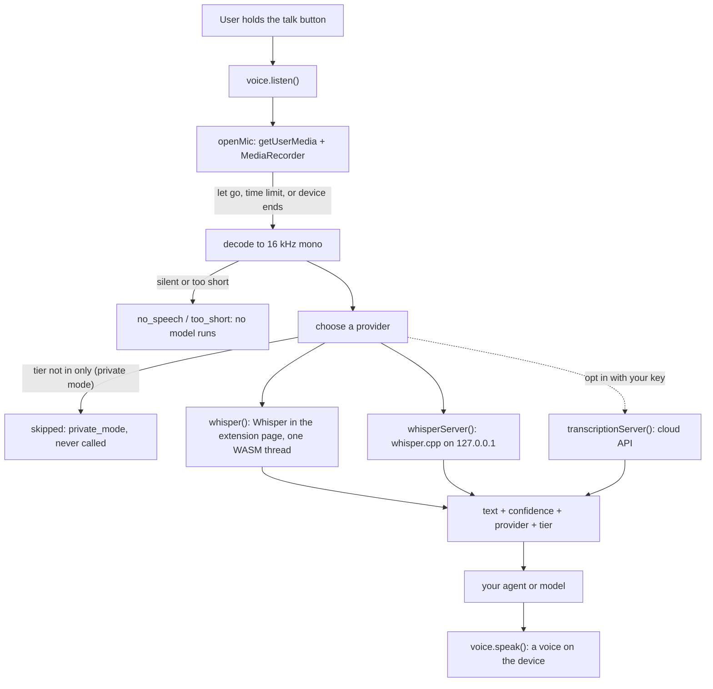
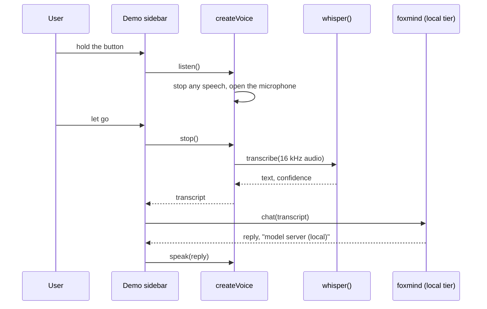
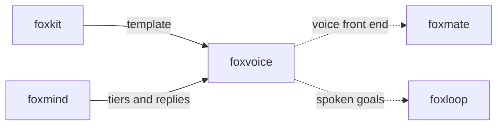

# foxvoice

Speak a goal to your Firefox agent and hear the result, with speech that stays on your device.

foxvoice gives a Firefox extension push to talk: `listen()` turns the
microphone on while the user holds a button, Whisper turns the audio into text
inside the extension page, and `speak()` reads the answer aloud with a voice
on the computer. Private mode is the default, so audio and text do not leave
the computer. A cloud speech service runs only when you opt in with your own
key.

## Install

```bash
npm i foxvoice
```

For Whisper in the browser, also install the optional peer dependency:
`npm i @huggingface/transformers`.

## Example

This runs in an extension page, such as a sidebar or a popup, after a bundler
such as esbuild. Copy ONNX Runtime's `ort-wasm-simd-threaded.asyncify.mjs` and
`.wasm` from `onnxruntime-web/dist` to `ort/` in the extension, as
`scripts/build-ext.mjs` does.

```js
import { createVoice } from "foxvoice";
import { whisper } from "foxvoice/browser";

const voice = createVoice({ stt: [whisper()] });
const button = document.querySelector("#talk");

button.addEventListener("pointerdown", async () => {
  const heard = await voice.listen();
  console.log(heard.text, heard.confidence, `${heard.provider} (${heard.tier})`);
  await voice.speak(`You said: ${heard.text}`);
});
button.addEventListener("pointerup", () => voice.stop());
```

When the microphone plays `e2e/extension/jfk.wav`, as in the E2E test, the
log line reads as follows. The confidence was between 0.88 and 0.90 in our runs.

```text
And so my fellow Americans ask not what your country can do for you, ask what you can do for your country. 0.8885567526339256 whisper (browser)
```

## Use cases

| Who | What they build | How foxvoice helps |
|---|---|---|
| An agent builder (foxmate, foxloop) | A voice front end: say a goal, hear the result | `listen()` gives the goal as text, and `speak()` reads the agent's answer. In private mode, neither leaves the computer. |
| A Firefox extension developer | Voice notes or dictation in an extension | `whisper()` runs in the extension page with no server and no account. |
| An accessibility tool | Read results aloud and take spoken commands | `speak()` picks a voice on the device and waits for Firefox's voice list, which is empty at first. |
| A team with a speech server | Dictation that uses whisper.cpp on the same computer | `whisperServer()` talks to `whisper-server`. Its tier is `local`, so private mode allows it. |
| A developer who pays for a cloud service | Better accuracy for other languages | `transcriptionServer()` takes your own key for any service with the OpenAI transcription API. It runs only when `only` includes `"cloud"`. |
| A researcher | A check of how well small Whisper models hear in a browser | The E2E test measures the word error rate and the confidence on a known WAV file in real Firefox. |

## How it works



The microphone is on only between `listen()` and `stop()`. Every way out
(let go, `cancel()`, the time limit, an error) stops every track. foxvoice
checks the audio before any model runs: silence fails with `no_speech`, and a
short press fails with `too_short`.



Firefox has no speech recognition that a web page can use, so foxvoice does
not use `SpeechRecognition`. Firefox's own `browser.trial.ml` engine has no
speech recognition task either, so foxvoice runs Whisper with transformers.js.
Extension pages have no `SharedArrayBuffer`, so ONNX Runtime uses one WASM
thread.

## API

### `foxvoice`

| Export | What it does |
|---|---|
| `createVoice({ stt, only?, prefer?, fallbackOnError?, mic?, tts? })` | Makes a voice. `only` is the list of tiers that may run; the default `["browser", "local"]` is private mode. A provider in another tier is never probed or called, and goes into `skipped` with code `private_mode`. `prefer` takes provider names or tiers and only changes the order. |
| `voice.listen({ signal?, maxMs?, language? })` | Turns the microphone on and resolves with the transcript: `{ text, confidence?, provider, tier, model, ms, audioMs, stoppedBy, skipped }`. It stops any speech first. A second call while the microphone is on fails with `busy`. |
| `voice.stop()` / `voice.cancel()` | Let go (transcribe what came) / drop the audio or stop the speech (`aborted`). |
| `voice.transcribe(audio)` | Transcribe 16 kHz samples (`Float32Array`) or a `Blob` the browser can decode, without the microphone. |
| `voice.speak(text, options?)` | Speak with a voice on the device. In private mode, a voice whose `localService` is false fails with `voice_not_local`. |
| `voice.on(event, listener)` | Events: `state` (`idle`, `listening`, `transcribing`, `speaking`), `level` (0 to 1, about 10 times a second), `transcript`, `error`. Returns a function that removes the listener. |
| `voice.status()` | Each provider's state, where it runs and its download progress. |
| `openMic({ maxMs?, minMs?, minLevel?, signal?, constraints?, onLevel?, media? })` | The microphone on its own. Returns `{ stop, cancel, done }`; `done` gives 16 kHz samples. Defaults: 30 s limit, 300 ms minimum, 0.01 silence level. |
| `speak(text, { voice?, lang?, rate?, pitch?, volume?, localOnly?, signal?, timeoutMs? })`, `listVoices()` | Text to speech on its own. `localOnly` defaults to true. |
| `transcriptionServer({ baseURL, model?, apiKey?, tier?, responseFormat?, timeoutMs? })` | Any server with the OpenAI `/audio/transcriptions` API. The tier comes from the URL: only `localhost`, `127.0.0.1` and `[::1]` are `local`. It sends a 16 kHz WAV file, refuses redirects, refuses a key over plain `http:` to another computer, and hides the key in errors. |
| `whisperServer({ port?, model? })` | whisper.cpp's `whisper-server` on `127.0.0.1:8178`. |
| `decodeAudio(blob)`, `encodeWav(samples)`, `loudness(samples)` | Audio helpers. |
| `FoxvoiceError` | Every failure. `code` is one of `unsupported`, `mic_denied`, `no_microphone`, `mic_busy`, `busy`, `too_short`, `too_long`, `no_speech`, `bad_audio`, `aborted`, `timeout`, `bad_input`, `no_provider`, `private_mode`, `unreachable`, `auth`, `model_not_found`, `rate_limited` (with `retryAfterMs`), `http`, `insecure`, `bad_response`, `download_failed`, `out_of_memory`, `webgpu_missing`, `no_voice`, `voice_not_local`, `tts_failed`. |

### `foxvoice/browser`

| Export | What it does |
|---|---|
| `whisper({ model?, device?, dtype?, language?, remoteHost?, wasmPaths? })` | Whisper in the page. Default model: `onnx-community/whisper-tiny.en` at `q8` (English only, 43 MB). `device` is `"wasm"` (default), `"webgpu"` or `"auto"`. Confidence is the mean probability that the model gave each word piece it wrote. Audio over 30 s fails with `too_long`. |

To run whisper.cpp on this computer:

```bash
brew install whisper-cpp
curl -LO https://huggingface.co/ggerganov/whisper.cpp/resolve/main/ggml-tiny.en.bin
whisper-server -m ggml-tiny.en.bin --port 8178 --inference-path /v1/audio/transcriptions
```

There is no CLI and no MCP server. Speech needs a microphone and a speaker in
the browser, so a CLI would add little.

### Demo extension

Install from AMO: [addons.mozilla.org/firefox/addon/foxvoice](https://addons.mozilla.org/firefox/addon/foxvoice/)
(pending AMO review; the link works after approval).

`extension/` is a small Firefox extension. The toolbar button opens a sidebar
with a hold-to-talk button. Hold it, or hold Space on it, while you speak. The
sidebar shows the transcript with its confidence, asks a model server on this
computer for a reply through foxmind (private mode), and speaks the reply.
Without a model server, the reply says so and repeats what it heard. If the
sidebar cannot get the microphone, a button opens a setup page in a tab, where
Firefox can show its prompt.

Build it with `pnpm build:ext` and load `dist-ext/manifest.json` from
`about:debugging`. For replies, start llama-server on port 8080, or set the
server and model name in Settings (for Ollama: `http://127.0.0.1:11434/v1`).

## Tests

`pnpm ci:local` runs lint, typecheck, 59 unit tests and the build. The unit
tests use a fake microphone, a fake speech engine and fake servers over real
HTTP. `docs/failure-modes.md` lists each failure mode and its test. The tests
went in before the code.

`pnpm e2e` starts Firefox with the E2E build of the extension and gives the
microphone `e2e/extension/jfk.wav` (11 s of John F. Kennedy's inaugural
address, public domain, from whisper.cpp's samples) in place of a real
microphone. It writes `artifacts/e2e-<date>.json` (the date is in UTC). Results from our
run on 2026-10-09 (Firefox 157.0.1, Apple M3 Pro, headless, so WASM on one thread;
28 of 28 checks passed):

| Check | Result |
|---|---|
| Whisper tiny.en in Firefox: word error rate on jfk.wav | 0 % (punctuation aside) |
| Confidence: speech / 3 s of noise | 0.90 / 0.02 |
| Transcribe 11 s of audio, model loaded | 3.3 s |
| Load the model and transcribe twice at once (files from a local copy of the hub) | 10.8 s |
| whisper.cpp `whisper-server`, ggml-tiny.en, on this computer | 0 % word error rate, 0.2 s |
| Private mode: requests to the cloud trap server | 0 |
| `speak()`: first call in a fresh page / after a cancel | ends with a local voice / ends |
| Microphone after let go, cancel and the time limit | every track `ended` |
| Demo sidebar, opened as a tab: hold, Space, the pointer leaving the button | transcript right, reply spoken |

## Firefox APIs used

| API | MDN | Why |
|---|---|---|
| `navigator.mediaDevices.getUserMedia` | [MDN](https://developer.mozilla.org/en-US/docs/Web/API/MediaDevices/getUserMedia) | Turns the microphone on while the user holds the button. Background pages cannot use it, so foxvoice runs in the sidebar. |
| `MediaRecorder` | [MDN](https://developer.mozilla.org/en-US/docs/Web/API/MediaRecorder) | Records the audio until the user lets go. |
| `MediaStreamTrack.stop` | [MDN](https://developer.mozilla.org/en-US/docs/Web/API/MediaStreamTrack/stop) | Turns the microphone off on every way out. |
| `OfflineAudioContext.decodeAudioData` | [MDN](https://developer.mozilla.org/en-US/docs/Web/API/BaseAudioContext/decodeAudioData) | Decodes the recording and resamples it to 16 kHz for Whisper. |
| `AudioContext`, `AnalyserNode` | [MDN](https://developer.mozilla.org/en-US/docs/Web/API/AnalyserNode) | The level meter while the microphone is on. |
| `speechSynthesis`, `SpeechSynthesisUtterance` | [MDN](https://developer.mozilla.org/en-US/docs/Web/API/SpeechSynthesis) | Speaks the reply with a voice of the operating system. `SpeechSynthesisVoice.localService` tells private mode which voices stay on the device. |
| `<iframe>` per utterance | [MDN](https://developer.mozilla.org/en-US/docs/Web/HTML/Element/iframe) | Each iframe has its own speech queue, so a cancel cannot leave the page's queue stuck. |
| WebAssembly, `crossOriginIsolated` | [MDN](https://developer.mozilla.org/en-US/docs/Web/API/Window/crossOriginIsolated) | ONNX Runtime runs Whisper on one WASM thread, because extension pages have no `SharedArrayBuffer`. |
| WebGPU (`navigator.gpu.requestAdapter`) | [MDN](https://developer.mozilla.org/en-US/docs/Web/API/GPU/requestAdapter) | `device: "webgpu"` and `"auto"` check for an adapter before the download. |
| Cache Storage | [MDN](https://developer.mozilla.org/en-US/docs/Web/API/CacheStorage) | transformers.js keeps the model files, so the download happens once. |
| `fetch`, `FormData`, `AbortSignal.timeout`, `AbortSignal.any` | [MDN](https://developer.mozilla.org/en-US/docs/Web/API/AbortSignal/any_static) | Sends audio to a transcription server with a timeout, the caller's abort, and `redirect: "manual"`. |
| `sidebar_action`, `sidebarAction.toggle` | [MDN](https://developer.mozilla.org/en-US/docs/Mozilla/Add-ons/WebExtensions/API/sidebarAction/toggle) | The push-to-talk sidebar, opened from the toolbar button. |
| `action.onClicked` | [MDN](https://developer.mozilla.org/en-US/docs/Mozilla/Add-ons/WebExtensions/API/action/onClicked) | The toolbar button. |
| `tabs.create`, `runtime.getURL` | [MDN](https://developer.mozilla.org/en-US/docs/Mozilla/Add-ons/WebExtensions/API/tabs/create) | Opens the microphone setup page; finds ONNX Runtime's files in the extension. |
| `storage.local` | [MDN](https://developer.mozilla.org/en-US/docs/Mozilla/Add-ons/WebExtensions/API/storage/local) | Keeps the demo's settings. |
| `host_permissions` for `http://127.0.0.1/*` | [MDN](https://developer.mozilla.org/en-US/docs/Mozilla/Add-ons/WebExtensions/manifest.json/host_permissions) | The demo calls whisper-server and the model server on this computer. |
| `content_security_policy` with `'wasm-unsafe-eval'` | [MDN](https://developer.mozilla.org/en-US/docs/Mozilla/Add-ons/WebExtensions/manifest.json/content_security_policy) | Lets the extension compile WebAssembly. |
| `unlimitedStorage` | [MDN](https://developer.mozilla.org/en-US/docs/Mozilla/Add-ons/WebExtensions/manifest.json/permissions#unlimitedstorage) | Model files are tens of MB. |

## Limits

- **Model size.** The first `listen()` downloads Whisper tiny.en: 43 MB from
  Hugging Face. ONNX Runtime adds 26 MB of WASM to the extension. Larger
  models such as `onnx-community/whisper-base.en` (77 MB) work in Node with
  transformers.js; we did not test them in Firefox.
- **Latency.** On one WASM thread, 11 s of audio took 3.3 s on an Apple M3
  Pro that was busy with other jobs. Slower computers take longer. There are
  no partial transcripts while the user speaks.
- **Language.** The default model is English only. A multilingual model and
  the `language` option are built, but we tested only English in Firefox.
- **30 s per turn.** Whisper reads 30 s at a time. `listen()` stops at 30 s,
  and longer audio fails with `too_long`.
- **Push to talk only.** There is no wake word and no voice activity
  detection. The microphone is never on by itself.
- **WebGPU.** `device: "webgpu"` is built but not tested. Firefox has no
  WebGPU on Linux, Intel Macs, Android, or in headless mode.
- **The sidebar prompt.** We did not check by hand whether Firefox shows the
  microphone prompt for the sidebar. The setup page is the way to grant it in
  a tab; the E2E test checks that page with Firefox's fake media device.
- **Speech after a cancel.** Firefox 157 on macOS leaves a page's speech
  queue stuck after `cancel()` during speech. foxvoice speaks each text in its
  own iframe to avoid it. The E2E test checks the speech engine's events, not
  the sound itself.
- **Voices.** Firefox uses the voices of the operating system. On Linux it
  needs speech-dispatcher and a voice; without one, `speak()` fails with
  `no_voice`.
- **Android.** Not tested. Firefox for Android has no sidebar, and Whisper on
  one WASM thread on a phone is slow.
- **Cloud services.** We tested `transcriptionServer()` against fake servers
  and a real whisper.cpp server, but not against a cloud service with a real
  key.
- **Confidence** is the model's own word probability. It is not calibrated:
  use it to ask the user again, not as a guarantee.
- We ran the E2E test on macOS only.

## Part of the fox primitives



foxvoice uses foxmind's tier names (`browser`, `local`, `cloud`), and the demo
asks for replies through foxmind. foxmate and foxloop do not use foxvoice yet.

## License

[MIT](LICENSE)
